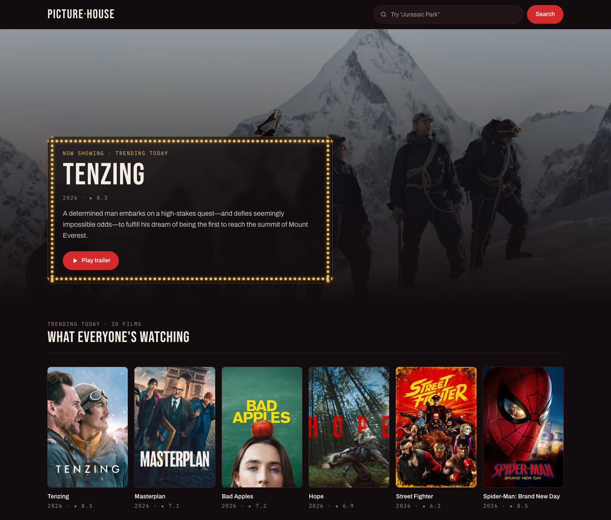

# Picture House: React movie trailer search 🎬

Search any film and watch its trailer. Built with React and [The Movie Database (TMDb)](https://www.themoviedb.org/) API.

**Live demo:** https://react-movies-search-alpha.vercel.app

## Features

- **Trending today**: the day's most-watched film, featured in a cinema-marquee hero.
- **Search by title**: a responsive poster grid with ratings and release years.
- **Trailer player**: opens the official YouTube trailer in a modal. It closes on Escape, on a backdrop click or with the close button.
- **Graceful states**: loading skeletons, empty results, network errors with retry, and films with no trailer.
- **Accessible**: keyboard-navigable cards, visible focus rings and `prefers-reduced-motion` support.

## Tech stack

| Area      | Tools                                                          |
| --------- | -------------------------------------------------------------- |
| Framework | React 19, TypeScript (strict)                                  |
| Build     | Vite                                                           |
| Styling   | Tailwind CSS v4 (design tokens in `src/index.css`)             |
| Testing   | Vitest, Testing Library, jsdom                                 |
| Linting   | ESLint (flat config) with typescript-eslint and React Hooks    |
| Runtime   | Node.js 24 LTS                                                 |

## Getting started

### Prerequisites

- Node.js 24 or later. If you use nvm, run `nvm use`, which reads `.nvmrc`.
- A TMDb API key. You can create one at <https://www.themoviedb.org/settings/api>.

### Setup

```bash
git clone https://github.com/fabriciocunhauk/React-Movies-Search.git
cd React-Movies-Search
npm install
cp .env.example .env   # then set VITE_TMDB_TOKEN to your TMDb API key
npm run dev
```

The app runs at <http://localhost:3000>.

> **Note:** Vite exposes `VITE_*` variables to the browser bundle. Use a read-only TMDb v3 API key, never a private secret.

### Scripts

| Command                 | Description                          |
| ----------------------- | ------------------------------------ |
| `npm run dev`           | Start the dev server                 |
| `npm run build`         | Type-check and build to `dist/`      |
| `npm run preview`       | Preview the production build         |
| `npm test`              | Run tests in watch mode              |
| `npm run test:coverage` | Run tests once with a coverage report |
| `npm run typecheck`     | Type-check the project               |
| `npm run lint`          | Lint the project                     |
| `npm run format`        | Format the project with Prettier     |

## Project structure

```
src/
  api/          TMDb client and response parsers (payload validation)
  components/   Presentational UI, one component per file
  config/       Environment and TMDb configuration
  hooks/        State and side effects (movies, trailer, dialog)
  pages/        Page composition
  types/        Shared TMDb domain types
  utils/        Pure helpers
```

## Deploying to Vercel

Vercel detects Vite automatically and serves the `dist/` folder. In **Project → Settings → Environment Variables**, set `VITE_TMDB_TOKEN`. It replaces the old `REACT_APP_TOKEN`.

## Contributing

1. Fork the repository.
2. Create a feature branch: `git checkout -b feature/amazing-feature`.
3. Commit your changes: `git commit -m "Add amazing feature"`.
4. Push the branch: `git push origin feature/amazing-feature`.
5. Open a pull request.

---

This product uses the TMDb API but is not endorsed or certified by TMDb.

Developer: Fabricio Cunha. Project: https://github.com/fabriciocunhauk/React-Movies-Search
